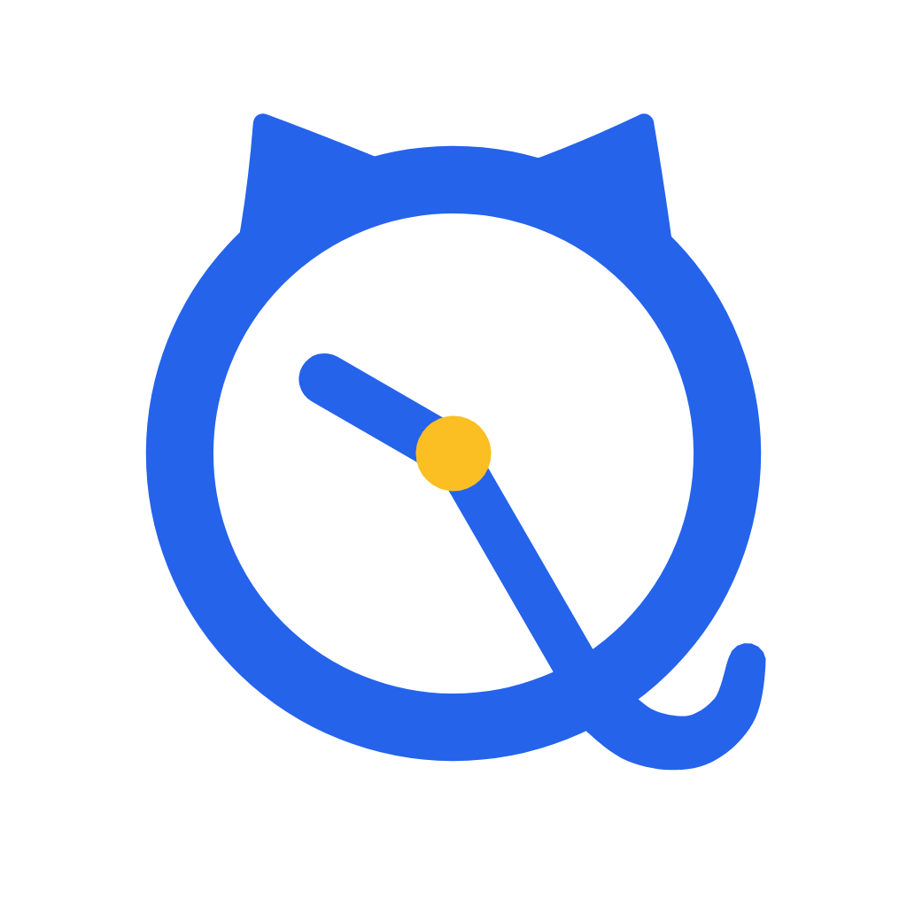

<div align="center">
  
  <h1>TheBell</h1>
  <p>以 50 分钟学习 + 10 分钟休息为节奏的学习时钟、计划与倒数日应用</p>
  <p>
    
    
    
  </p>
</div>

---

TheBell 面向考研、自学考试、语言考试、职业资格考试，以及任何需要长时间专注学习的场景。应用以「50 分钟专注 + 10 分钟休息」为核心节奏，将一天的作息展开为可勾选的时间线，配合每日学习任务与目标倒数日，帮助维持稳定的复习节奏。

- **完全离线**：所有数据保存在本地（SQLite / localStorage），不联网、不上传
- **Android 原生 APK**：基于 Capacitor 7，平板横屏使用左侧导航 + 双栏布局，手机使用底部导航
- **iPadOS 就绪**：同一套 Web 代码，`ios/App` 工程已生成，可在 macOS 上用 Xcode 构建签名

## 功能特性

### 节奏与计时

- **50/10 节奏模板**：默认只保留早 / 午 / 晚起居节点，其余时间自动切成 50 分钟学习 + 10 分钟休息；时间段类型、起止时间、内容与顺序均可编辑
- **时间线视图**：今日节奏按开始时间排成纵向时间线，已完成的项可一键收起
- **分段倒计时**：左右箭头切换时段（也可直接点时间线），支持开始 / 暂停 / 重置 / 本段完成；倒计时时长由起止时间自动推导，修改时间后立即生效
- **独立计时器**：可创建任意数量的自定义计时器，各自设置时长与颜色，可同时运行

### 计划与任务

- **计划自定义**：默认 100 天，范围 1–1000 天；开始日期可改，日期自动顺延
- **每日任务**：数学 / 专业课 / 外语 / 公共课 / 其他五个科目，逐条勾选、编辑、删除
- **任务继承与顺延**：之前未完成的任务可自动出现在今天（默认自动顺延，也可切换为手动顺延）；单条任务可顺延到明天 / 后天，或通过自绘的年 / 月 / 日滚轮日期选择器指定日期
- **倒数日**：主倒数 + 多个目标日，支持六套渐变背景、颜色与置顶

### 个性化

- **首页布局自定义**：卡片可显示 / 隐藏、整行 / 左栏 / 右栏、栏内上下排序，自由选择要展示的计时器与倒数日
- **自绘选择器**：时间（时 / 分双滚轮）与日期（年 / 月 / 日三滚轮）均为自绘组件，与应用视觉一致
- **主题**：浅色 / 深色 / 跟随系统

### 数据管理

- **JSON 导入 / 导出**：包含计划、任务、作息、打卡状态、计时状态、倒数日与主题，可跨设备迁移
- **平台信息**：设置页显示真实系统版本与厂商 UI 版本（小米 HyperOS / MIUI），运行时读取，无额外权限

## 下载安装

前往 [Releases](https://github.com/TGP258/TheBell/releases) 下载对应版本：

| 变体 | 软件名 | 包名 | 说明 |
|---|---|---|---|
| Beta（开发版） | TheBell Beta | `pascal.thebell` | 跟随 `dev` 分支，更新频繁，包含最新功能 |
| Stable（稳定版） | TheBell | `pascal.thebell.std` | 跟随 `main` 分支，更新节奏更慢，适合长期使用 |

两个变体可以并存安装；数据保存在各自的应用目录中，互不影响。

## 技术栈

| 层 | 选型 |
|---|---|
| UI | Vue 3 + TypeScript + Vite，手写设计系统 |
| 跨平台 | Capacitor 7 |
| 本地数据库 | Android 原生 SQLite（自定义 `PascalDb` 插件），浏览器环境降级为 `localStorage` |
| 备份格式 | JSON（`thebell/v1`），兼容旧版 `studyplan/v1` |

## 本地开发

环境要求：Node 20+、JDK 21、Android SDK 35（build-tools 35.0.0）。

```bash
npm install
npm run dev            # 浏览器预览（数据存 localStorage）
npm run build          # 类型检查 + 生产构建
npx cap sync android   # 同步 Web 资源到 Android 工程
```

### Android 构建

```bash
cd android
./gradlew assembleDevDebug     # 开发变体（TheBell Beta）
./gradlew assembleStableDebug  # 稳定变体（TheBell）
```

产物位于 `android/app/build/outputs/apk/{dev,stable}/debug/`。

### iOS

`ios/App` 工程已生成（需在 macOS 上构建，CocoaPods 依赖由 `cap sync ios` 安装）：

```bash
npm install && npm run build
npx cap sync ios
open ios/App/App.xcworkspace
```

## 仓库结构

本仓库采用**单仓库双基线**：`dev` 分支为开发版基线（日更节奏），`main` 分支为稳定版基线（月更节奏）。包名、软件名与图标的差异由 Product Flavors 管理（`dev` / `stable` 两个变体），业务代码在两条分支间完全同源；软件名与版本号在运行时通过 `DeviceInfoPlugin` 注入，避免标识类代码进入业务逻辑。

```
src/
  views/              今日 / 计划 / 计时 / 倒数日 / 设置
  components/         首页卡片、时间与日期滚轮选择器、各类编辑对话框
  stores/plan.ts      Pinia 状态：计划、作息、计时系统与业务动作
  lib/
    storage/          StorageDriver：native(SQLite) / web(localStorage)
    deviceinfo.ts     设备与应用信息（软件名 / 版本号运行时注入）
    backup.ts         JSON 构建、校验与恢复
    seed.ts           默认 100 天计划 + 50/10 节奏模板
android/
  app/src/main/       共享代码与资源（PascalDb、DeviceInfo 插件）
  app/src/dev/        dev 变体资源（启动图标、应用内品牌图）
  app/src/stable/     stable 变体资源
ios/App/              Xcode 工程
scripts/
  logo.py             生成 logo SVG 与 Android 自适应图标矢量层
  render_icons.mjs    用无头 Chrome 将 SVG 光栅化为各密度 PNG / iOS 图标
```

## 数据存储

### SQLite（Android）

| 表 | 说明 |
|---|---|
| `plan(id=1)` | 名称、开始日期、总天数 |
| `day(idx, date)` | 第 idx 天对应的真实日期 |
| `task` | 每日任务（`id, day_idx, category, title, done, sort, created_at, done_at`） |
| `routine` | 全局作息模板（`kind = routine / study / break`，起止时间为分钟数，跨日 `>1440`） |
| `routine_check` | 按天打卡（联合主键） |
| `segment_timer` | 学习 / 休息段的按天倒计时状态 |
| `custom_timer` | 独立计时器 |
| `countdown` | 倒数日 |
| `meta` | 主题、首页布局与全局偏好 |

计时状态只存「剩余秒数 + 结束时间戳」：运行中由 `ends_at` 实时推算，不每秒写库；暂停时换算回 `remaining_sec`。因此应用切后台甚至被系统回收后，恢复时计时依然准确。

### JSON 备份（`thebell/v1`）

```json
{
  "app": "pascal.thebell",
  "format": "thebell/v1",
  "plan": { "name": "我的学习计划", "startDate": "2026-11-21", "totalDays": 100 },
  "routine": [
    { "start": "08:00", "end": "08:50", "title": "学习段 1", "kind": "study", "durationSec": 3000 }
  ],
  "days": [
    { "idx": 1, "date": "2026-11-21", "tasks": [{ "category": "math", "title": "真题一套", "done": false }], "routineDone": [0] }
  ],
  "countdowns": [{ "title": "目标日", "targetDate": "2027-01-01", "color": "violet", "pinned": true }]
}
```

导入时重新校验日期、科目、作息类型与时长，并重建 ID；导出的计时器统一转为暂停状态，避免跨设备恢复出现异常。

## 品牌资产

猫耳时钟：白色底、黑色圆环、暗金色轴心，分针指向 5 点后延伸为猫尾，圆环顶部两只带弧度的猫耳。

- 源文件：`resources/`（`icon.svg` 圆角底、`icon-square.svg`、`icon-round.svg`、`logo.svg` 透明底、`icon-monochrome.svg` 单色剪影、`icon-bw.svg` 黑白稿）
- 配色：黑 `#000000`、暗金 `#B8860B`、白 `#FFFFFF`
- 生成链路：`python scripts/logo.py` 输出 SVG 与 Android 矢量层，`node scripts/render_icons.mjs` 光栅化为各密度 PNG 与 iOS 图标
- Android 自适应图标：108dp 画布，纯白背景 + 矢量前景，图形控制在中心 66dp 安全区内；Android 13+ 支持 Monet 主题图标自动染色

## 版本历史

### Dev0.4.2204（dev）

- 仓库重组为单仓库双基线（`dev` / `main`），引入 Product Flavors 构建变体
- 软件名与版本号改由 `DeviceInfoPlugin` 运行时注入，业务代码不含构建标识

### Dev0.4.2203（dev）

- 品牌：LOGO 蓝色全部改为黑色，中心轴心改为暗金色，全量重生成图标资源
- 名称体系：开发版软件名调整为 TheBell Beta

### Dev0.4.2202（dev）

- 设置页平台信息改为运行时获取（Android 版本 + HyperOS / MIUI）
- 学习任务新增顺延模式设置（自动 / 手动）；继承任务可折叠；今日节奏支持收起已完成项

### Dev0.4（dev）

- 全新猫耳时钟 logo 与矢量自适应图标（含 Monet 主题图标）

### Dev0.3（dev）

- 自绘时间选择器；首页卡片组件化，支持布局自定义；倒数日主卡六套渐变背景

### Dev0.2（dev）

- 今日节奏改为纵向时间线；倒计时时长由起止时间推导；新增快捷时长

## 已知边界

- 单计划模型：暂不支持多计划切换、账号同步与云备份
- 暂无通知提醒、桌面小组件与后台常驻计时（切后台后按时间戳继续，不发系统通知）
- iOS 工程已生成，尚未在 macOS 上完成编译与签名验证

## 许可

本项目暂未设置开源许可证，代码与品牌资源版权归项目作者所有。
